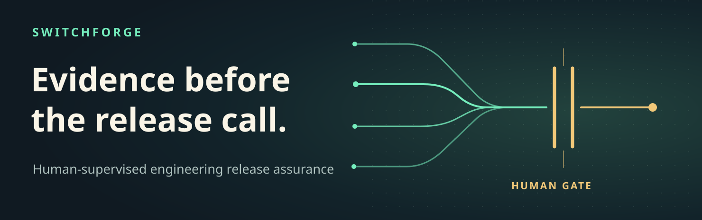
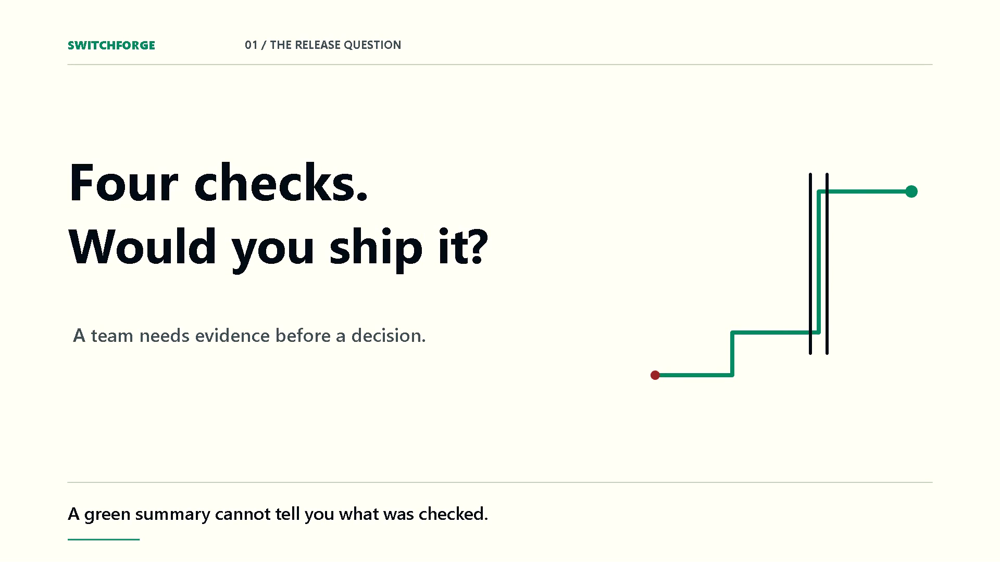
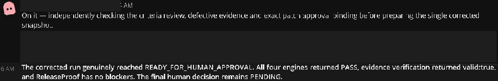
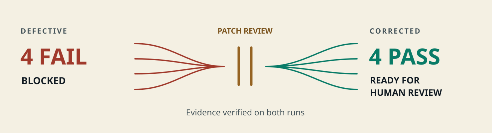
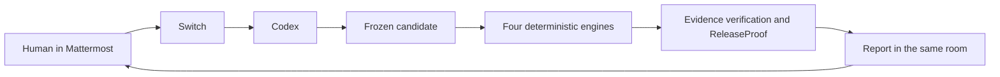

# SwitchForge

**Your agent runs the checks. Your team makes the call.** SwitchForge helps a release reviewer answer a question a green chat summary cannot: _which candidate was checked, and can I inspect the evidence?_ A human asks in Mattermost, **Switch routes the conversation to Codex**, and the agent returns four checks on the same frozen checkout candidate to the room.

**[Watch the 2:32 demo](https://github.com/YellankiKaushik/Flip-Coin-AI/releases/download/switchforge-demo-2026-v2/SwitchForge-2026-editorial-v2.mp4)** · [Reproduce it](docs/getting-started/README.md) · [Inspect the evidence](docs/hackathon/DEMO.md) · [Browse the docs](docs/README.md)

## What happened in the room

This is a crop of the **actual existing Codex reply** in Switch Console’s Mattermost view. The agent verifies the human’s separately recorded patch decision, runs the corrected candidate, and reports in the conversation where the request began. [Capture provenance](docs/assets/README.md).

**Why Switch matters:** the CLI can reproduce the checks locally. Switch supplies the shared room context, routes the human’s request to the dedicated Codex agent, and returns its work to the same thread. Without Switch, that human-to-agent handoff and return loop is absent from the demonstrated workflow. [Configure Switch and Mattermost](docs/switch/SWITCH_GUIDE.md).

## Four failures. A reviewed correction. Four passes.

| Check                | Actual defect and correction                                                            | Tool                              |
| -------------------- | --------------------------------------------------------------------------------------- | --------------------------------- |
| **AcceptanceRelay**  | Coupon accepted at exact expiry → rejects at the UTC boundary. Six approved tests pass. | Vitest                            |
| **A11yRelay**        | Unlabeled email input → explicit visible label.                                         | Playwright, Chromium, axe-core    |
| **ContractGuardian** | Removed JSON response media type → restored `application/json`.                         | oasdiff                           |
| **DataRescue**       | Synthetic 500-cent mismatch → order and ledger agree.                                   | csv-parse and deterministic rules |

Both runs have valid evidence. ReleaseProof recorded `BLOCKED` for the defective run and `READY_FOR_HUMAN_APPROVAL` for the corrected run, with zero blockers. See the [actual agent table and checkout evidence](docs/hackathon/DEMO.md).

## The human decides

1. **`CRITERIA_REVIEW`** binds the criteria and acceptance tests.
2. **`PATCH_REVIEW`** binds the exact correction to the defective candidate.
3. **`RELEASE_READINESS`** is a separate interactive decision after technical readiness.

The final Level 1 decision remains recorded as **`HUMAN_ATTESTED_FOR_DEMO`**. Its current effective state is **`EXPIRED`**. Agent output does not authorize release. [Review procedure and evidence](docs/human-review/PROCEDURE.md).

## How the proof is built

The candidate binds inputs, reviewed tests, policy, lockfile, and tool identities. ReleaseProof checks the run, manifest, evidence references, and completion marker. Missing, stale, failed, or mismatched evidence blocks readiness. [Architecture and trust boundaries](docs/architecture/ARCHITECTURE.md).

## Reproduce and inspect

Use Windows x64, Node `24.16.0`, npm `11.9.0`, pinned Playwright Chromium, and checksum-verified oasdiff `1.35.0`. Follow the [setup guide](docs/getting-started/README.md) for the exact install and diagnostic commands, then [connect your own room](docs/switch/SWITCH_GUIDE.md) and follow the [human procedure](docs/human-review/PROCEDURE.md) for a reviewed reproduction.

The complete suite passed **137 tests across 19 files**. The [testing guide](docs/testing/TESTING.md) separates automated fixtures from actual human review and explains the seven Windows CI jobs.

| Find                                          | Where                                     |
| --------------------------------------------- | ----------------------------------------- |
| CLI and checkout fixture                      | [apps](apps)                              |
| Engines, coordinator, evidence store, policy  | [packages](packages)                      |
| Input inventory, pins, and release policy     | [config](config) and [fixtures](fixtures) |
| Unit, integration, security, and E2E tests    | [tests](tests)                            |
| Setup, architecture, provenance, and archives | [docs](docs/README.md)                    |

## Scope, credits, and license

Synthetic checkout only: no real payments or production deployment. Level 1 is manual attestation, without cryptographic identity proof. axe tests the configured label rule, oasdiff compares OpenAPI documents, and CSV reconciliation covers narrow deterministic cases. Local hashes and SQLite are not an independently anchored immutable audit store; an actor who controls both can alter them. Windows x64 is the tested platform.

Built by [Yellanki Kaushik](https://github.com/YellankiKaushik) with Codex for **Flip the Switch Hackathon 2026 — Best Business Workflow**. See the [official challenge](https://www.wemakedevs.org/hackathons/switch), [submission checklist](docs/hackathon/CHECKLIST.md), [Apache-2.0 license](LICENSE), and [third-party notices](THIRD_PARTY_NOTICES.md). The [history index](docs/history/README.md) preserves earlier audits, artwork, and the first film.
