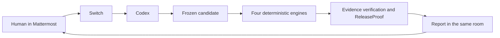

# SwitchForge


**Human-Supervised Engineering Release Assurance**

**Flip the Switch Hackathon 2026 · Best Business Workflow (Track 1)**

SwitchForge helps developers, QA engineers, engineering teams and release reviewers answer a practical question: _Which candidate did the agent check, and can I inspect the evidence before I decide?_ A human asks in Mattermost. Switch routes the request to Codex, which runs four engineering checks against a frozen synthetic checkout and reports the actual results in the same conversation. The human owns the review decisions.

[](https://github.com/YellankiKaushik/Flip-Coin-AI/actions/workflows/ci.yml)

**[Watch the 2:32 demo on YouTube](https://www.youtube.com/watch?v=CSaoyadNdL8)** · [Download the GitHub v2 MP4](https://github.com/YellankiKaushik/Flip-Coin-AI/releases/download/switchforge-demo-2026-v2/SwitchForge-2026-editorial-v2.mp4) · [Inspect the demo evidence](docs/hackathon/DEMO.md)

[](https://www.youtube.com/watch?v=CSaoyadNdL8)

## Contents

- [Problem and workflow](#the-release-review-problem)
- [Actual demo and architecture](#actual-demo-results)
- [Prerequisites and installation](#prerequisites)
- [Automated tests and first diagnostic](#run-the-automated-tests)
- [Switch Console, Codex and Mattermost](#configure-switch-console)
- [First human-agent workflow and review gates](#run-your-first-human-agent-workflow)
- [Evidence integrity and troubleshooting](#evidence-integrity-and-releaseproof)
- [Source, scope and hackathon](#codebase-navigation)

## The release-review problem

An AI agent can make a change and report green tests. A reviewer still has to know whether those tests ran against the exact candidate and covered the agreed behavior. A checkout can still accept an expired coupon, lose a field label, break an API contract, or disagree with its ledger. A chat summary gives the team a starting point. A release decision needs inspectable evidence and a human who can review the exact correction without asking the agent to approve its own work.

## What SwitchForge does

**Mattermost** is the team chat. **Switch** connects the room and the existing coding agent, passes shared context to the agent, and routes its results back. **Codex** is the AI agent that invokes the scoped **SwitchForge CLI**. The CLI freezes the candidate, runs four deterministic software checks, verifies evidence, and evaluates readiness through **ReleaseProof**. The reviewer inspects the results in the same room and records decisions separately through the interactive CLI.



Codex's reply below is a genuine redacted capture from the existing Mattermost thread. It reports what the agent found after checking the human's separately recorded patch review and running the corrected candidate. [Capture provenance](docs/assets/README.md)


## Actual demo results


| Check                                           | Defective candidate                                          | Corrected candidate                                               |
| ----------------------------------------------- | ------------------------------------------------------------ | ----------------------------------------------------------------- |
| AcceptanceRelay · Vitest                        | **FAIL** — coupon accepted at exact expiry                   | **PASS** — exact UTC boundary rejects. Six reviewed tests passed. |
| A11yRelay · Playwright, Chromium and axe        | **FAIL** — checkout email input lacked an accessible label   | **PASS** — visible explicit label restored.                       |
| ContractGuardian · oasdiff                      | **FAIL** — documented JSON response media type removed       | **PASS** — restored `application/json`.                           |
| DataRescue · csv-parse and reconciliation rules | **FAIL** — synthetic order and ledger disagreed by 500 cents | **PASS** — order and ledger agree.                                |

Both runs had valid evidence. The defective assessment was **`BLOCKED`**. The corrected assessment was **`READY_FOR_HUMAN_APPROVAL`** with zero blockers. The separate final human decision remains recorded as **`HUMAN_ATTESTED_FOR_DEMO`**. Its latest effective state is **`EXPIRED`**. The historical record remains available after its effective validity ends. [Actual agent table and checkout captures](docs/hackathon/DEMO.md)

## Architecture

1. The TypeScript CLI prepares a snapshot from the selected synthetic scenario. A canonical hash manifest binds candidate inputs, criteria, tests, configuration, policy, lockfile and toolchain identities. [CLI composition](apps/cli/src/program.ts) · [Manifest code](packages/core/src/infrastructure/hash-manifest.ts)
2. The run coordinator resolves the four checks and records status, coverage and evidence. Chromium checks the loopback checkout. The other adapters run Vitest, compare OpenAPI documents, or reconcile CSV records. [Coordinator](packages/core/src/application/run-checks.ts) · [Check engines](packages/checks)
3. The artifact store publishes references and hashes, and SQLite retains run and review records. ReleaseProof revalidates the manifest, required checks, review bindings, evidence inventory and completion record. `compare` evaluates and displays the two runs and each check's before-and-after status. [Artifact store](packages/evidence/src/artifact-store.ts) · [Ledger](packages/evidence/src/ledger.ts) · [Assessment](packages/release/src/assessment.ts)
4. The agent returns the findings to the room. The human separately reviews the criteria, the correction and release readiness. Each review binds a specific resource and uses its own interactive action. [Architecture details](docs/architecture/ARCHITECTURE.md) · [Review procedure](docs/human-review/PROCEDURE.md)

## Prerequisites

| Requirement                                         | How it is supplied                                                                                                                             |
| --------------------------------------------------- | ---------------------------------------------------------------------------------------------------------------------------------------------- |
| Windows x64, PowerShell, Git and Windows `tar`      | Install or enable on the operator's machine. Windows x64 is the tested platform.                                                               |
| Node `24.16.0` and npm `11.9.0`                     | Install and select these exact versions before cloning. The provider must select the same pins.                                                |
| Playwright `1.65.0` and matching Chromium           | `npm ci` installs the pinned package. Its CLI downloads Chromium `158.0.8127.18`, revision `1254`.                                             |
| oasdiff `1.35.0`                                    | The repository installer downloads the binary and checks both archive and executable hashes.                                                   |
| Native SQLite dependency                            | `npm ci` installs pinned `better-sqlite3` for the ledger. Check the Node version and Windows x64 ABI if it cannot load.                        |
| Switch Console, its local server and Docker Desktop | Set up separately for the room workflow. Docker supplies the bundled Mattermost setup used in the demo.                                        |
| Codex and Mattermost                                | Bring a configured Codex provider and sign in to Mattermost privately. The standalone CLI diagnostic uses only local tools and synthetic data. |

## Install on Windows

Run these steps in PowerShell. Use a clean folder where you can install dependencies and write project-local test evidence.

1. Clone the public repository and enter its root.

   ```powershell
   git clone https://github.com/YellankiKaushik/Flip-Coin-AI.git
   cd Flip-Coin-AI
   ```

   A successful clone contains `package.json`, `config/`, and `fixtures/`. If cloning fails, check Git availability, network access, and whether the destination already exists. If changing directories fails, check the clone location.

2. Check the executables that this shell will use.

   ```powershell
   node --version
   npm --version
   ```

   Expect `v24.16.0` and `11.9.0`. If either differs, inspect resolution with `Get-Command node,npm -All`, select the pinned installation and rerun the checks.

3. Install dependencies from the lockfile, then install Chromium through the locally installed Playwright package.

   ```powershell
   npm ci
   npx playwright install chromium
   ```

   Each command should exit zero. `npm ci` installs the workspace dependencies, including Vitest, Playwright and the native SQLite module. The browser installer makes the matching binaries available to Playwright. If either step fails, check the first error, the pinned toolchain and download access. If the provider cannot read the default browser cache, set `PLAYWRIGHT_BROWSERS_PATH` to a project-local cache before installing and use the same setting in the actual provider process.

4. Install oasdiff and run the CLI doctor.

   ```powershell
   powershell -NoProfile -File scripts/install-oasdiff.ps1
   npm --silent run sf -- doctor --json
   ```

   The installer verifies both hashes and prints oasdiff `1.35.0`. For a checksum error, check the pinned release and retry the installer. Doctor should exit zero with `ok: true` and report the resolved toolchain. If it exits nonzero, read its structured error or the shell launch error and fix the reported dependency or directory before proceeding. [Pinned tool configuration](config/toolchain-expected.json)

## Run the automated tests

```powershell
npm test
npm run typecheck
npm run lint
npm run format:check
npm run docs:check
npm run integrity
```

| Command                              | What it verifies                                                                                                  |
| ------------------------------------ | ----------------------------------------------------------------------------------------------------------------- |
| `npm test`                           | Vitest unit, integration, security and local end-to-end tests, including package boundaries.                      |
| `npm run typecheck` / `npm run lint` | Static TypeScript checking. Lint currently runs the same TypeScript command.                                      |
| `npm run format:check`               | Prettier checks the configured source and documentation paths.                                                    |
| `npm run docs:check`                 | Tracked local Markdown link destinations outside fenced blocks. External URLs and anchors are outside this check. |
| `npm run integrity`                  | Checks protected reference hashes when the originals are present. A public checkout reports their exclusion.      |

The verified baseline is **137 tests across 19 files**. Your results describe your current checkout. GitHub Actions runs seven jobs covering installation, type checking, unit, integration, security, artifact contracts and docs links. The job count is separate from the test count. [Testing guide](docs/testing/TESTING.md) · [CI workflow](.github/workflows/ci.yml)

## Run your first diagnostic

Use a fresh public checkout from its root. This run prepares the defective synthetic scenario, writes new local evidence, and leaves all human reviews untouched. The helper checks both native exit codes and CLI JSON responses.

```powershell
function Read-SwitchForgeJson([string[]]$CliArgs) {
    $output = npm --silent run sf -- @CliArgs --json
    $code = $LASTEXITCODE
    $result = $output | ConvertFrom-Json -ErrorAction Stop
    if ($code -ne 0 -or -not $result.ok) {
        throw "SwitchForge exit $code. $($result.error.message)"
    }
    return $result.data
}

$candidate = Read-SwitchForgeJson -CliArgs @('prepare', '--scenario', 'defective', '--candidate', 'checkout-demo')
$key = 'diagnostic-' + [Guid]::NewGuid().ToString('N')
$run = Read-SwitchForgeJson -CliArgs @('run', '--snapshot', $candidate.snapshotId, '--key', $key)
$run.results | Select-Object checkId,status,coverage

$runId = $run.run.runId
$report = Read-SwitchForgeJson -CliArgs @('report', '--run', $runId)
$report.assessment | Select-Object readiness,blockers
Read-SwitchForgeJson -CliArgs @('verify-evidence', '--run', $runId)
$report | ConvertTo-Json -Depth 12
```

On the fresh unreviewed fixture, AcceptanceRelay returns `ERROR` because it lacks reviewed criteria and tests. The other three checks can expose their synthetic defects, and ReleaseProof returns `BLOCKED`. This is the intended fail-closed diagnostic. A successful CLI call completed an operation. Valid evidence means the stored record can be verified. A check PASS applies to one check. READY means the full technical policy was met. Human readiness approval requires a separate interactive decision. [CLI reference](docs/getting-started/CLI.md)

## Configure Switch Console

Switch Console is the desktop app for connecting to a Switch server and managing agents and rooms. The public checkout supplies the CLI and fixtures. Install Console and configure authentication separately.

1. Install the Windows x64 build using the official installation page. Start Docker Desktop and run `docker info` to check that its engine responds before opening Console for the bundled Mattermost setup.
2. Open Console and select **Get started**, then choose the supported local server option or sign in to an existing Switch server. Console can run its local core without Docker. The bundled Mattermost setup used in the demo requires Docker.
3. Check the server is running in Console and open its **Home**. **Messaging apps** should show the Mattermost connection. If Docker was installed after Console opened and the bundled app is absent, reopen Console after Docker is healthy and inspect the server's supported status and restart controls. Preserve the existing server, rooms and data.

The demonstrated integration used Console 0.40.1, Core 0.31.0, and Mattermost 11.9.0. These labels come from the official guides and may differ by build, server setup and administrator role. [Install Console](https://docs.switchagents.ai/switch-rooms/getting-started/install-switch-console) · [Add a server](https://docs.switchagents.ai/switch-rooms/getting-started/add-a-server)

## Connect Codex

1. In **Your Agents**, add an agent with a local name, for example `release-review-agent`. Set **Run location** to the Windows host with the checkout and **Directory** to the root containing `package.json`, `config/` and `fixtures/`. Select **Codex** as the **Agent provider**. The operator installs and signs in to the provider on that host.
2. Give the agent the [runner instructions](docs/switch/switchforge-runner.md). Keep **Bypass permissions** disabled. In **Auto mode** the provider still decides which actions need approval. Scope actual permissions to the pinned npm entry point and `doctor`, `prepare`, `run`, `verify-evidence`, `report`, `compare`, and read-only `criteria inspect`. If a Windows wrapper cannot launch, authorize an exact operator-verified Node/npm invocation only where supported. Agent instructions describe the boundary and provider settings enforce it.
3. Run doctor through the provider before running the fixture. A normal terminal and the provider can resolve different npm wrappers and browser caches. Keep review attestations, arbitrary shell or Node execution, deployment and publication outside the agent's scope. [Onboard an agent](https://docs.switchagents.ai/switch-rooms/getting-started/onboard-your-agents) · [Agent settings](https://docs.switchagents.ai/switch-rooms/getting-started/agent-settings)

## Connect Mattermost

1. On the Switch server's **Home**, find the bundled Mattermost connection under **Messaging apps**. Open **Sign-in details…**, sign in privately, and link your Mattermost account when prompted. If using an existing Mattermost server, its administrator follows the official connection instructions. [Connect Mattermost](https://docs.switchagents.ai/switch-rooms/deploy/messaging-apps/mattermost)
2. In **Your Rooms**, select **Create room**, choose the **Mattermost** connection, name it for the workflow, and add the Codex agent. For an existing channel, use the documented connection steps and **Add to room** for the agent as needed. Confirm that the room appears in Switch and that the human and agent are members of its Mattermost channel. [Create or connect a room](https://docs.switchagents.ai/switch-rooms/getting-started/create-a-room)
3. From Mattermost, replace the placeholder with the registered agent mention or room alias and send the following request yourself.

   ```text
   @YOUR_AGENT Run the allowed SwitchForge doctor --json from the configured repository root. Reply in this thread with the actual exit code and JSON. Stop after doctor.
   ```

   Check for a command-backed reply in the same conversation with exit zero and `ok: true`. A reply with a dependency or launch error confirms routing while identifying a separate runner issue. [Full room guide](docs/switch/SWITCH_GUIDE.md)

## Run your first human-agent workflow

These steps are for a new room and fresh records. The published film shows a completed historical run.

1. Post the doctor request above. Switch routes the request, Codex runs the permitted command and returns its actual result in the same room. Inspect the result and resolve any dependency error.
2. Review the acceptance criteria and exact tests before recording **CRITERIA_REVIEW** through your own interactive terminal. Use the [canonical human review procedure](docs/human-review/PROCEDURE.md) and actual IDs returned by your checkout.
3. Ask Codex to prepare and verify the defective snapshot. Inspect the four results, run ID, candidate digest, evidence validity and assessment it posts to the room.
4. Review the exact patch against that defective candidate. Only after you record a separate **PATCH_REVIEW** should the agent verify the binding and check a fresh corrected snapshot under the same candidate ID with a new run key.
5. Have Codex verify both evidence bundles and compare the actual run IDs using `compare --before` and `--after`. Keep the comparison in the Mattermost conversation.
6. If the corrected run is technically ready, personally review the assessment and decide through the separate **RELEASE_READINESS** action. Read the resulting report for the recorded decision and effective state. A chat message can refer to the decision and the CLI verifies its actual binding. [Human review procedure](docs/human-review/PROCEDURE.md) · [Historical demo](docs/hackathon/DEMO.md)

## Human review gates

| Gate                | Who and what                                                                      | Binding and timing                                                                                                                                          |
| ------------------- | --------------------------------------------------------------------------------- | ----------------------------------------------------------------------------------------------------------------------------------------------------------- |
| `CRITERIA_REVIEW`   | A human inspects the exact criteria and acceptance tests before the reviewed run. | Binds the criteria resource and test digests used by the acceptance check.                                                                                  |
| `PATCH_REVIEW`      | A human inspects the exact changes that address the defective findings.           | Binds the patch digest and defective base candidate.                                                                                                        |
| `RELEASE_READINESS` | A human inspects the corrected evidence and technical assessment after READY.     | Binds the corrected run, candidate, assessment and policy. The effective decision expires under policy and can become superseded if the assessment changes. |

Interactive proposals have an expiry window. Level 1 records cooperative reviewer identity without cryptographic verification. A green check alone cannot establish who reviewed the underlying inputs or whether the final decision remains effective. The demo's genuine historical record is `HUMAN_ATTESTED_FOR_DEMO` and its latest effective state is `EXPIRED`. [Review implementation](packages/release/src/approval.ts)

## Evidence integrity and ReleaseProof

| State                      | Meaning                                                                                                      |
| -------------------------- | ------------------------------------------------------------------------------------------------------------ |
| `PASS`                     | One check met its rule for this candidate.                                                                   |
| `FAIL`                     | One check found a real violation.                                                                            |
| `ERROR`                    | A check could not establish its result, such as when the acceptance review prerequisite is missing.          |
| `BLOCKED`                  | The full technical policy did not pass. Failed, missing, stale or inconsistent evidence can block readiness. |
| `READY_FOR_HUMAN_APPROVAL` | Technical prerequisites passed and a human can separately review readiness.                                  |
| `HUMAN_ATTESTED_FOR_DEMO`  | A separate interactive human decision was recorded for the demo.                                             |
| `EXPIRED`                  | The effective decision's validity has ended. Its historical record persists.                                 |

ReleaseProof compares candidate and tool identity with the evidence hashes, required result inventory, completion record and policy. A valid four-FAIL report correctly proves that the defective candidate was blocked. Hashes check consistency within the local trust boundary. An actor who controls both the ledger and the filesystem can alter that record. [Evidence architecture](docs/architecture/ARCHITECTURE.md)

## Troubleshooting

| Problem                          | Likely cause                                                   | Safe diagnostic                                                                     | Resolution                                                                                               |
| -------------------------------- | -------------------------------------------------------------- | ----------------------------------------------------------------------------------- | -------------------------------------------------------------------------------------------------------- |
| Wrong working directory          | Shell or provider opened elsewhere                             | Check `Get-Location` and the presence of `package.json`, `config/`, and `fixtures/` | Select the public checkout root in the shell or agent.                                                   |
| Wrong Node/npm                   | A different executable or npm wrapper was selected             | Run `Get-Command node,npm -All` and check versions in the actual runner             | Select the pinned executables and rerun doctor.                                                          |
| Missing packages                 | Installation failed or was run elsewhere                       | Read `npm ci` output and check the checkout root                                    | Resolve the first install error and rerun `npm ci`.                                                      |
| Missing or inaccessible Chromium | Browser install failed or the runner cannot launch it          | Read the doctor error from the actual provider                                      | Install the matching browser and check provider access to that cache.                                    |
| Wrong browser cache              | Shell and provider inherit different environments              | Compare `PLAYWRIGHT_BROWSERS_PATH` in both processes                                | Select one project-local cache for the install and runner, then rerun doctor.                            |
| oasdiff hash or install error    | Wrong release asset, incomplete download or extraction failure | Read the installer's archive or executable check                                    | Retry the pinned installer using the official release and keep both hash checks.                         |
| Native SQLite load error         | Incorrect Node ABI, architecture or incomplete native install  | Check Windows x64, Node pin and the `npm ci` error                                  | Restore the supported runtime and reinstall from the lockfile.                                           |
| Agent unreachable                | Provider signed out, wrong mention or room membership          | Check agent readiness, room membership and the addressed name                       | Restore provider access and retry the same-room doctor request.                                          |
| Mattermost channel unlinked      | Wrong connection or human account                              | Check **Messaging apps**, linked identity, and **Your Rooms**                       | Use the supported account linking and room controls.                                                     |
| Command denied                   | Provider scope or launcher rejected execution                  | Inspect the actual provider approval or launch error                                | Use the exact verified permitted invocation with the provider's normal approval controls.                |
| Criteria review missing          | No matching reviewed criteria and tests were consumed          | Read the blockers in `report`                                                       | For a reviewed run, inspect and attest interactively using the canonical procedure.                      |
| Invalid or stale evidence        | Missing artifact, changed inputs or mismatched tool identity   | Run `verify-evidence` and read the report                                           | Preserve the run, fix the cause and prepare a new snapshot.                                              |
| Expired decision                 | Effective policy window elapsed                                | Read recorded and effective states in `report`                                      | For a current candidate, inspect a fresh valid assessment and make a new decision only when appropriate. |
| Quoting or JSON error            | Arguments were joined or shell output was mixed into JSON      | Check the exit code and capture stdout before parsing                               | Use the argument array and `--silent` invocation above. Keep each returned ID as its own argument.       |

[Recovery runbook](docs/engineering/RUNBOOKS.md)

## Codebase navigation

```text
apps/cli/                 CLI startup, arguments and composition
apps/checkout-demo/       Loopback checkout server and acceptance tests
packages/core/            Candidate identity, configuration and run coordination
packages/checks/          Deterministic checks and tool adapters
packages/evidence/        Artifact publication and SQLite ledger
packages/release/         ReleaseProof and interactive review
config/                   Tool pins, input inventory and check policy
fixtures/scenarios/       Defective and corrected synthetic inputs
scripts/                  Setup, integrity, docs and CI helpers
tests/                    Unit, integration, security and local E2E tests
docs/                     Project guides and evidence provenance
.github/                  CI workflow and tool setup
```

Start with the quickstart above, then read the [project map](docs/PROJECT_MAP.md), [CLI entry](apps/cli/src/main.ts), [engines](packages/checks), [policy](packages/release/src/policy.ts), and [tests](tests). Ordinary development changes tracked source, tests or docs through normal review. A changed candidate needs a fresh snapshot. Local tools and operator records live under `.local/`. Generated run evidence lives under `artifacts/`. Private originals and immutable artifacts remain outside public Git to protect operator data and preserve the actual records. The repository includes selected redacted evidence. [Documentation index](docs/README.md)

## Security and scope

The project uses a synthetic checkout with no real payments, bank transactions, customer data, or production deployment. Windows x64 is tested. The axe check covers one configured label rule. API coverage is OpenAPI document comparison and CSV reconciliation covers narrow deterministic cases. Level 1 is cooperative manual identity. The filesystem and SQLite ledger are local trust boundaries, with no externally anchored immutable audit log. Real-world productivity and commercial impact were not measured.

## Video and demo evidence

The YouTube film shows the real Switch Console, human request, and Codex reply as retained still captures. The edited film labels its evidence summaries and shows the actual corrected report. Start at **0:19** for the human request and **1:22** for the four-engine result. Use YouTube for the hosted demo and the GitHub MP4 as an archive. [YouTube demo](https://www.youtube.com/watch?v=CSaoyadNdL8) · [V2 MP4](https://github.com/YellankiKaushik/Flip-Coin-AI/releases/download/switchforge-demo-2026-v2/SwitchForge-2026-editorial-v2.mp4) · [Original film and provenance](docs/history/DEMO-v1.md) · [Complete timestamp guide](docs/hackathon/DEMO.md)

## Hackathon

SwitchForge is an independent prototype built by [Yellanki Kaushik](https://github.com/YellankiKaushik) with Codex for **Flip the Switch Hackathon 2026 — Best Business Workflow**. The entry addresses accountable release review when an AI agent assists engineering work. Switch makes the existing agent part of the shared team conversation and returns the real verification findings in context. The demo shows a human request, Switch routing, Codex execution, four defects, a human-reviewed correction, and corrected verification. The human makes the release-readiness decision. [Official event](https://www.wemakedevs.org/hackathons/switch) · [Project problem overview](docs/hackathon/PROJECT_OVERVIEW.md) · [Entry checklist](docs/hackathon/CHECKLIST.md)

[Apache-2.0 license](LICENSE) · [Third-party notices](THIRD_PARTY_NOTICES.md) · [Project history](docs/history/README.md)
