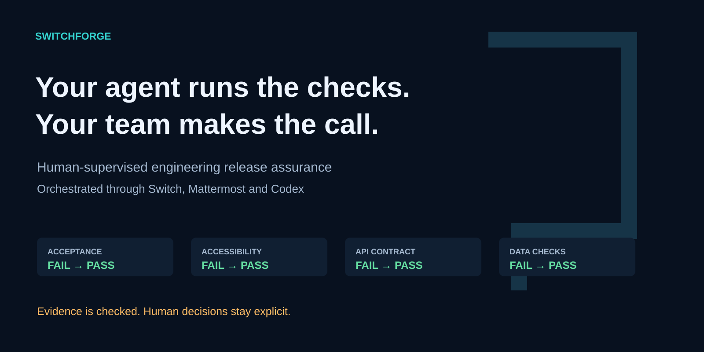
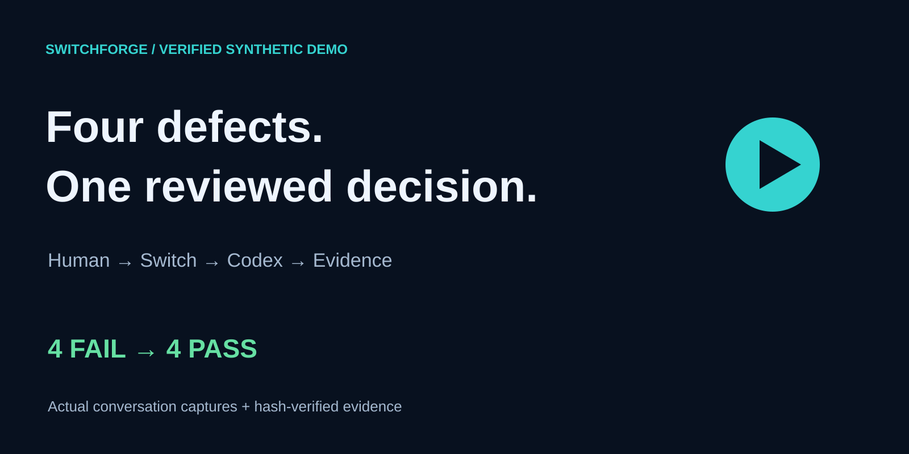
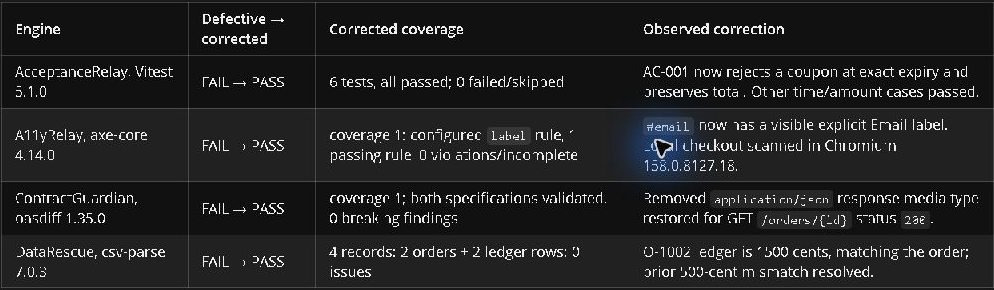
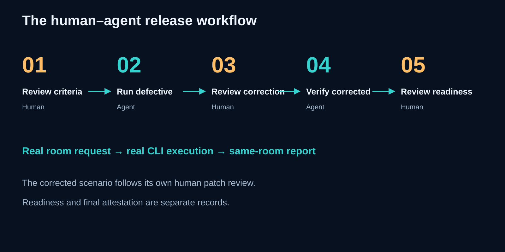
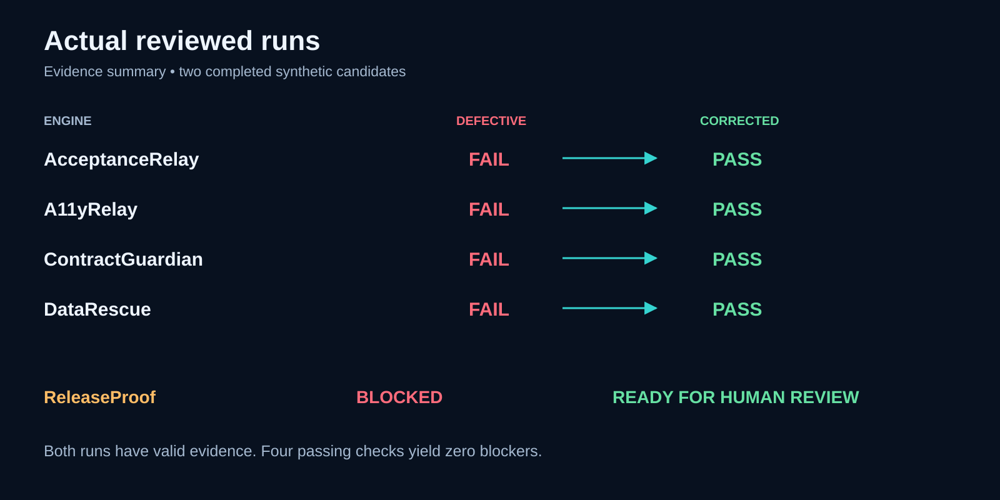
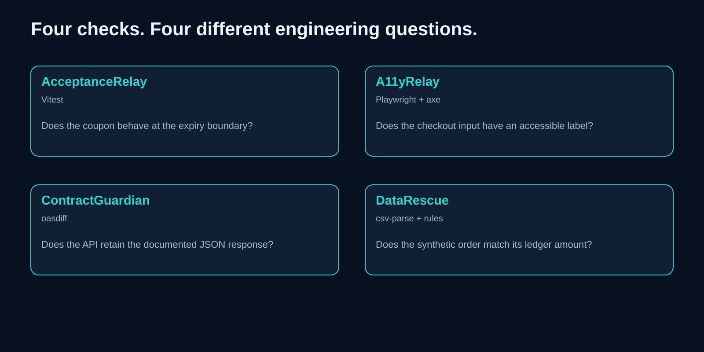
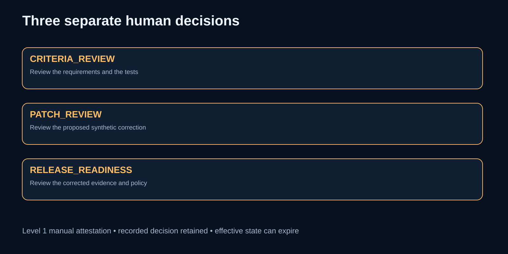
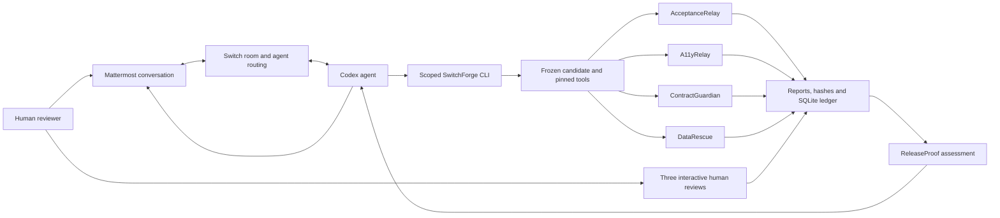

# SwitchForge

### Your agent runs the checks. Your team makes the call.



SwitchForge brings release verification into the team conversation. A human asks in Mattermost, **Switch connects Codex to the room**, and four deterministic engines turn a frozen candidate into inspectable evidence and a human-gated readiness decision.

[](https://github.com/YellankiKaushik/Flip-Coin-AI/actions/workflows/ci.yml)
   

[Watch the 2:45 demo](https://github.com/YellankiKaushik/Flip-Coin-AI/releases/download/switchforge-demo-2026-11-07/SwitchForge-2026-demo.mp4) � [Demo and evidence](docs/DEMO.md) · [Real before/after](#the-demonstration) · [Run it yourself](#run-it-yourself) · [Documentation](docs/README.md)

Built for **Flip the Switch Hackathon 2026 · Best Business Workflow**.

## Watch the workflow



**Edited demo video — final render and publication in progress.** The film uses captures of the actual existing Switch conversation and clearly labeled visualizations of the completed run records. The hosted URL will be added after media verification. [Demo provenance and chapters](docs/DEMO.md).



The table above is a cropped capture of the real agent report inside Switch Console's Mattermost view. The original conversation and immutable run evidence are retained privately. [Asset provenance](docs/assets/README.md).

## Release review has an evidence problem

A green summary can hide the wrong candidate, an incomplete scan, a changed test, a broken contract, or a stale approval. A chat response alone gives a reviewer little way to establish which code was checked and whether every required result belongs to that candidate.

SwitchForge freezes the inputs, runs the tools, retains raw reports, and checks their identity before assessing readiness. The human sees the findings where the work was requested and makes three distinct review decisions.

## Why Switch is central

The product workflow begins and ends in a shared room. Mattermost supplies the conversation. Switch routes the addressed request and shared context to the configured Codex agent. Codex executes the scoped CLI commands and returns the actual findings to that same conversation. The human reviews the proposed correction, then asks for the corrected run.

Switch makes the agent available as a teammate throughout that review. The deterministic CLI can also be run directly for reproduction. Removing Switch removes the shared human-to-agent room workflow demonstrated here.



## The demonstration

Two genuine reviewed snapshots of the same synthetic checkout were executed through the configured Switch agent. The corrected snapshot followed a separate human patch review.

| Engine               | Defective | Corrected                | What changed                                                                    |
| -------------------- | --------- | ------------------------ | ------------------------------------------------------------------------------- |
| **AcceptanceRelay**  | FAIL      | PASS                     | A coupon now rejects exactly at its UTC expiry boundary                         |
| **A11yRelay**        | FAIL      | PASS                     | The checkout email input gains an explicit accessible label                     |
| **ContractGuardian** | FAIL      | PASS                     | The order response restores its documented JSON media type                      |
| **DataRescue**       | FAIL      | PASS                     | A synthetic 500-cent ledger difference is corrected against the order authority |
| **ReleaseProof**     | BLOCKED   | READY_FOR_HUMAN_APPROVAL | Four valid passing results yield zero blockers                                  |

Both runs had valid evidence. Validation establishes that the reports match their recorded inputs and hashes. A valid FAIL report still blocks readiness.



### Recorded decision and effective state

The human completed **CRITERIA_REVIEW**, **PATCH_REVIEW**, and **RELEASE_READINESS** separately. The final CLI recorded `HUMAN_ATTESTED_FOR_DEMO` at Level 1, and it was effective at completion. A later canonical read returned effective `EXPIRED` under the existing expiry policy. The recorded decision remains part of the history. Its current effectiveness is a separate policy result.

Level 1 relies on manual review and cooperative identity. It does not provide cryptographic human identity or production deployment authorization.

## Four verification engines

| Engine           | Actual tools                            | Corrected coverage                           | Boundary                                           |
| ---------------- | --------------------------------------- | -------------------------------------------- | -------------------------------------------------- |
| AcceptanceRelay  | Vitest 5.1.0                            | Six acceptance tests, all passed             | The reviewed coupon criteria and exact test source |
| A11yRelay        | Playwright 1.65.0, Chromium, axe 4.14.0 | One configured `label` rule, zero violations | Automated input-label testing                      |
| ContractGuardian | oasdiff 1.35.0                          | One API comparison, zero breaking findings   | OpenAPI document-level compatibility               |
| DataRescue       | csv-parse 7.0.3 and deterministic rules | Four records, zero reconciliation issues     | Two orders and two synthetic ledger rows           |

The checks use different engineering tools. Candidate preparation, storage, policy, and portions of validation remain shared infrastructure.



## Three human gates

1. **Criteria review** binds the human's review to the requirements and acceptance-test content.
2. **Patch review** binds the reviewed correction to the defective snapshot and patch digest.
3. **Final readiness review** binds the final human decision to the corrected candidate, assessment, and policy.

The agent gathers and explains evidence. The reviewer personally enters the canonical interactive confirmation. Chat approval alone leaves the application ledger unchanged. [Portable human review procedure](ACTION_REQUIRED_FROM_HUMAN.md) · [Exact synthetic correction](PATCH_REVIEW_PACKET.md).



## How evidence becomes a verdict

Preparation hashes the selected source, fixtures, reviewed tests, lockfile, configuration, policy and actual toolchain into a candidate manifest. Checks execute against the frozen snapshot. Raw reports, normalized results and coverage are stored with hash references. A completion record binds the full artifact inventory.

ReleaseProof requires all four distinct checks, positive coverage, matching candidate and policy identities, eligible reviewed criteria/tests, and complete valid artifacts. Missing, ERROR, SKIPPED, stale, tampered or nonpassing results block readiness. Reusing an idempotency key with the same request returns its original run. Corrections get a new snapshot.

Hashes detect inconsistency. A hostile same-account actor who can rewrite both the files and database can forge the local history. Storage is cooperative, and this prototype makes no hardware-backed or externally anchored audit guarantee.

## Architecture



The runtime is one local CLI with bounded workers and a loopback checkout fixture. Switch, Mattermost and Codex provide external orchestration. [Implementation architecture](docs/ARCHITECTURE.md).

## Capability and evidence matrix

| Capability                    | Actual outcome                                                      | Limits                                                    |
| ----------------------------- | ------------------------------------------------------------------- | --------------------------------------------------------- |
| Human-to-agent room execution | Demonstrated through the real configured Switch and Mattermost room | An existing local integration, with private room receipts |
| Defect detection              | All four defective checks returned FAIL                             | Deliberately authored synthetic defects                   |
| Corrected validation          | All four checks passed with valid evidence                          | Narrow, declared tool coverage                            |
| Human reviews                 | Three separate Level 1 records                                      | Manual cooperative identity and expiry                    |
| Automated regression          | 137 tests passed across 19 files                                    | Isolated test records do not grant demo authority         |
| Public CI                     | Seven Windows jobs passed on the implementation push and PR         | Current branch status is shown by GitHub Actions          |
| Deployment                    | Local prototype                                                     | Production deployment is outside this project             |

## Run it yourself

Use **Windows x64, Node 24.16.0 and npm 11.9.0**. Git and system `tar` are required. The package lock pins JavaScript dependencies. Initial setup downloads the matching browser and the checksum-pinned oasdiff release.

```powershell
git clone https://github.com/YellankiKaushik/Flip-Coin-AI.git
cd Flip-Coin-AI
node --version
npm --version
npm ci
npx playwright install chromium
powershell -NoProfile -File scripts/install-oasdiff.ps1
npm --silent run sf -- doctor --json
```

If browser access differs across execution environments, install the matching browser into an operator-selected workspace cache and set `PLAYWRIGHT_BROWSERS_PATH` for that process. Use the installed pinned Playwright CLI. The same cache must be visible to the actual runner. Doctor retains exact version and executable-hash validation. [Environment baseline](docs/ENVIRONMENT_BASELINE.md).

### A diagnostic run

```powershell
$candidate = npm --silent run sf -- prepare --scenario defective --candidate checkout-demo --json | ConvertFrom-Json
if (-not $candidate.ok) { throw $candidate.error.message }
$run = npm --silent run sf -- run --snapshot $candidate.data.snapshotId --key first-defective-run --json | ConvertFrom-Json
$run.data.results | Select-Object checkId,status,coverage
npm --silent run sf -- verify-evidence --run $run.data.run.runId --json
npm --silent run sf -- report --run $run.data.run.runId --json
```

Before actual criteria/test review, AcceptanceRelay reports ERROR and ReleaseProof blocks. Follow the [human procedure](ACTION_REQUIRED_FROM_HUMAN.md) to reproduce the reviewed defective and corrected workflow. Use actual returned IDs and fresh snapshots. A CLI operation's exit 0 does not imply a ready candidate.

### Connect the room

Configure a dedicated Codex agent in Switch Console with this checkout as its directory. Bridge a Switch room to Mattermost with the human reviewer and agent. Keep provider permission protections enabled and scope commands to the reviewed CLI. Use the [Switch setup guide](docs/SWITCH_GUIDE.md) and [runner guidance](docs/agents/switchforge-runner.md). Then send an actual human request and retain its same-room response.

## Tested toolchain

| Tool                               | Exact tested version                          |
| ---------------------------------- | --------------------------------------------- |
| Node / npm                         | 24.16.0 / 11.9.0                              |
| TypeScript / tsx                   | 7.0.2 / 4.23.15                               |
| Vitest                             | 5.1.0                                         |
| Playwright / Chromium headless     | 1.65.0 / 158.0.8127.18, revision 1254         |
| axe / oasdiff                      | 4.14.0 / 1.35.0                               |
| better-sqlite3 / csv-parse         | 13.0.3 / 7.0.3                                |
| Switch Console / Core / Mattermost | Recorded integration 0.40.1 / 0.31.0 / 11.9.0 |

Other operating systems and browser distributions have no verified support in this release.

## Tests and CI

```powershell
npm run typecheck
npm run lint
npm run format:check
npm test
npm run docs:check
npm run integrity
```

The latest full sanitized-clone run passed **137/137 across 19 files**, zero failures or skips. The 625 policy-state combinations are exercised inside one unit test. Lint currently uses the TypeScript static check. Integrity verifies protected references when they are present locally and reports their intentional omission from a public checkout.

The seven actual Actions jobs are `dependency-install`, `typecheck`, `unit`, `integration-checks`, `security-smoke`, `artifact-contract` and `docs-link-check`. Every job passed on both the [implementation push](https://github.com/YellankiKaushik/Flip-Coin-AI/actions/runs/42335780195) and [PR run](https://github.com/YellankiKaushik/Flip-Coin-AI/actions/runs/42335865503). [Testing details and evidence boundaries](docs/TESTING.md).

## Repository map

```text
apps/cli/                 Strict JSON CLI and interactive review commands
apps/checkout-demo/       Loopback synthetic checkout and acceptance tests
packages/core/            Models, snapshots, tool inventory and coordinator
packages/checks/          Four real verification engines
packages/evidence/        Canonical hashes, artifacts and SQLite persistence
packages/release/         ReleaseProof and human review lifecycle
fixtures/scenarios/       Versioned defective and corrected synthetic inputs
config/                   Pinned tools, input inventory and release policy
tests/                    Unit, integration, security and local E2E suites
docs/                     Architecture, setup, evidence and media provenance
.github/                  Seven-job Windows CI and pinned tool setup
```

## Privacy, provenance and rights

Only distributable source and reviewed public media are published. The original specification references, private room receipts, review database, authentication material and tool caches remain outside the public repository. The public history retains the meaningful development sequence with privacy-safe documentation.

The banner and diagrams are original vector artwork. Screenshots come from the actual local synthetic demo and recorded conversation. Cropping and opaque redactions remove private references. Evidence summaries are explicitly labeled. No model-generated screenshot is presented as proof. [Media provenance](docs/assets/README.md).

## Hackathon alignment

**Best Business Workflow** is the intended track. Switch supplies the shared human-agent review loop, while deterministic tools make results reproducible. The business problem is practical release-review coordination. Impact beyond this controlled demo remains a hypothesis.

Official judging covers Switch use, technical execution, creativity/impact, and presentation/documentation. The public deliverables are a repository, a short workflow video, and reproducible Switch setup documentation. Submission closes November 7, 2026 at 11:59 PM IST. The owner personally submits the authenticated entry. [Official challenge](https://www.wemakedevs.org/hackathons/switch) · [Schedule](https://www.wemakedevs.org/hackathons/switch/schedule) · [Rules](https://www.wemakedevs.org/hackathons/switch/rules).

## Documentation

| Start here                      | Read                                                                                           |
| ------------------------------- | ---------------------------------------------------------------------------------------------- |
| Understand the implementation   | [Architecture](docs/ARCHITECTURE.md)                                                           |
| Configure Switch and Mattermost | [Switch guide](docs/SWITCH_GUIDE.md)                                                           |
| Review exact commands and exits | [CLI reference](docs/CLI.md)                                                                   |
| Reproduce human gates           | [Human procedure](ACTION_REQUIRED_FROM_HUMAN.md) and [criteria packet](HUMAN_REVIEW_PACKET.md) |
| Inspect the correction          | [Patch packet](PATCH_REVIEW_PACKET.md)                                                         |
| Evaluate tests and artifacts    | [Testing](docs/TESTING.md) and [runbooks](docs/RUNBOOKS.md)                                    |
| Inspect film and captures       | [Demo](docs/DEMO.md) and [asset provenance](docs/assets/README.md)                             |
| Explore every guide             | [Documentation index](docs/README.md)                                                          |

## Scope and next steps

The demo uses synthetic checkout and CSV data. It processes no real payment or bank ledger. Accessibility is the configured label rule. API validation compares OpenAPI documents. CSV reconciliation follows narrow deterministic rules. Windows x64 is the tested platform. The same user account controls the local files and ledger.

Possible future work includes stronger independently verified reviewer identity, externally anchored evidence, additional accessibility and contract coverage, and additional platform support. Each would require its own implementation and acceptance evidence.

## Credits and license

Built by [Yellanki Kaushik](https://github.com/YellankiKaushik) with Codex for the Flip the Switch Hackathon. Switch and Mattermost provide the collaboration environment. Vitest, Playwright/Chromium, axe, oasdiff, csv-parse and SQLite tooling provide deterministic checks and persistence.

Project source uses the [Apache License 2.0](LICENSE). Dependency versions and license notices are indexed in [the dependency manifest](docs/dependencies.lock.json) and [third-party notices](docs/licenses/README.md).
