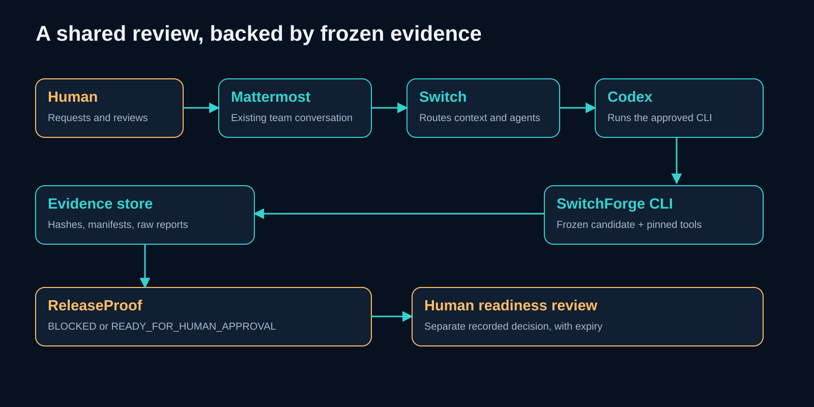

# Implementation architecture

The protected root DEEP_TECHNICAL_ARCHITECTURE_V2.md is authoritative and has not been modified. This file describes the implemented components. The private original specification remains a local reference.

## Components

| Path                                        | Implemented responsibility                                                      |
| ------------------------------------------- | ------------------------------------------------------------------------------- |
| apps/cli/src/main.ts and program.ts         | Dependency-safe bootstrap, strict grammar, JSON envelopes and operator commands |
| apps/checkout-demo/src/server.ts            | Loopback-only snapshot checkout and /__source identity response                 |
| packages/core/src/domain/models.ts          | Typed models and strict boundary schemas                                        |
| packages/core/src/infrastructure            | Path guards, raw-byte manifest, inventory and bounded subprocesses              |
| packages/core/src/application/run-checks.ts | One active run, candidate-scoped idempotency, lifecycle and orchestration       |
| packages/checks/src                         | Four deterministic checks; separate Node data/browser workers                   |
| packages/evidence/src                       | Canonical JSON, SQLite migration/ledger and nonoverwriting artifact storage     |
| packages/release/src                        | Fail-closed assessment, proposal lifecycle and interactive Level 1 attestation  |

No extra messaging system, model runtime, microservice fleet or database server is introduced. Switch/Mattermost/Codex remain external. Domain policy does not call an LLM or browser.

## Candidate lifecycle

prepare copies allowlisted code/config/lockfile inputs and the chosen versioned scenario to a fresh .local/snapshots UUID. It computes sorted raw byte hashes and a canonical manifest with reviewed criteria/test identities, policy/check configuration and toolchain metadata. Every required glob must match. The explicit input configuration includes verifier code and SQL migration.

The manifest excludes volatile run IDs and timestamps. Its digest is recomputed before/after checks and on reads; inventory changes and changed current verifier inputs invalidate current use. Separate prepared snapshots are used for defective/corrected scenarios. No prepared file is intentionally edited during a run. Filesystem access remains cooperative; no hostile same-account immutability guarantee is made.

Effective check configuration follows committed config → .local/config.json → known SF_ environment values → explicit prepare overrides. Frozen canonical effective-checks.json is included in the input manifest. Unknown keys, unsafe storage paths, external sample URLs and unbounded values fail closed. Tool inventory hashes the actual matching Windows Chromium headless-shell executable, not the full-browser launcher.

## Execution and evidence

The coordinator acquires an exclusive PID/lease lock. The ledger records CREATED → VALIDATING → RUNNING → COMPLETED, or terminal INTERRUPTED. Four checks are sequential under an overall deadline. A legitimate domain defect is FAIL; missing review, malformed input/report, missing tool, resource exhaustion or interruption is ERROR. All mandatory nonpassing states block.

Each check preserves tool output/receipt, normalized result, coverage and hash references. Files are exclusively staged, flushed, atomically published without replacement and then recorded. SQLite foreign keys, WAL and full synchronous transactions are enabled. Cross-file/database crash windows are handled by rejecting incomplete/missing evidence, not by trusting orphaned JSON.

## Readiness and review

ReleaseProof validates four distinct required results, toolchain, candidate, policy, criteria/test review and artifacts. Historical evidence remains historical; superseded runs cannot authorize a newer candidate. Only an actual interactive human action can create a Level 1 attestation through the normal CLI; same-account isolation is not claimed. The completed demo recorded three separate human decisions. The final recorded Level 1 decision persists, while a later canonical read reports effective EXPIRED under the existing policy.

The real room workflow was completed through Mattermost, Switch and Codex. Its preserved private receipts are distinct from automated isolated test records.

## Final audit changes

Evidence publication uses an exclusively created, flushed temporary file and atomic same-volume hard-link creation, followed by temporary-link removal. This prevents an arriving writer from replacing an existing artifact; unsupported hard links fail rather than silently overwriting. A final `completion.json` is published last and binds the complete registered evidence inventory. Public assessment and evidence verification reject a run without this record, even if its SQLite status says COMPLETED. Older evidence lacking the new record remains preserved historical evidence and is not eligible for a current release.

New runs explicitly record criteriaRevision, policyDigest and toolchainDigest in their JSON ledger payload. Legacy rows are read compatibly but cannot satisfy the new assessment identity checks without those original bindings. This is an additive payload change, not a claim that a new SQL migration was executed. The canonical schema already has candidate-scoped key uniqueness; no history was rebuilt or deleted.

Cooperative snapshot monitoring additionally checks file metadata while a run is active and remembers observed changes, including bytes restored before a check finishes. Raw bytes remain the candidate identity. Windows recursive native fs.watch aborted the pinned Node worker in an actual test; the shipped implementation uses watchFile polling plus synchronous metadata checks. This is not a hostile-account immutability guarantee or proof that every possible transient edit is observable.

At release decision time, synchronous tool hash/package-version checks run inside the immediate transaction after a full live inventory before it. TTL is checked again immediately before consuming the nonce. Reports also recheck request expiry and candidate/assessment/policy bindings. Human approval remains pending; no positive human decision was manufactured to test these branches.

## Package interfaces and persistence validation

The CLI now composes the coordinator through CoordinatorLedger, ArtifactSink and CoordinatorServices ports. Core imports no other workspace package; checks cannot import release. Canonical hashing lives in the core domain, with the former evidence path retained as a compatibility re-export. Cross-package production imports use declared public entry points: core/public/domain, infrastructure and coordinator; evidence/index; checks/index; release/index; checkout-demo/index. The package-boundary test checks production import destinations and cycles, including type dependencies. This is source-level enforcement, not OS process isolation.

Snapshot, manifest, proposal, assessment, run and check-result payloads receive strict runtime validation. Snapshot metadata binds registry root, indexed identity and canonical manifest digest; readers do not silently adopt malformed historical data. Assessment hashes bind their payload and run candidate. Run identity is immutable before terminal completion, and transitions are explicit. Proposal scope cannot be retargeted during updates; malformed expiry cannot remain REQUESTED. JSON corruption is classified EVIDENCE_CORRUPT (exit 6), rather than an unclassified JSON parser failure. Existing valid history is retained; no SQL migration or database reconstruction was introduced. Criteria-content, audit-event and completion-record checks retain their existing specialized validation; this does not claim a universal versioned schema for every database row.

The seven specified CI jobs are declared separately. Each installs the tested Windows tools and invokes ci-proof to retain actual exits, command receipts, SHA, worktree state, lockfile hash, tool versions, job/run identifiers and timestamp. Only the job-specific redacted receipt directory is selected for upload. Local receipts are explicitly LOCAL_ONLY; neither they nor a green GitHub Actions run establish live Switch collaboration.
