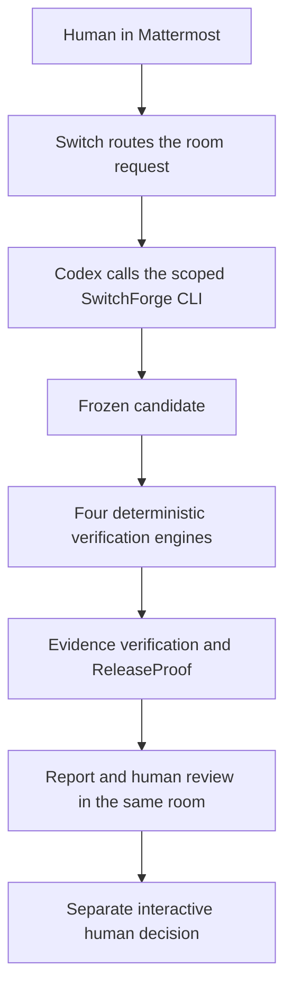

# SwitchForge project map

## How to explain SwitchForge in 60 seconds

A reviewer asks Codex to check a candidate in Mattermost. Switch carries the request and shared room context to Codex. The CLI freezes a synthetic checkout candidate, runs four deterministic checks, and records evidence for each. ReleaseProof checks those results against the frozen inputs and reviewed criteria. The first candidate had four failures and was blocked. After a separate human patch review, a corrected candidate passed all four checks and became ready for a separate human decision. The result returns to the same room. [Demo and evidence](hackathon/DEMO.md)



Codex is the AI agent in this workflow. The four engines are ordinary code and tool adapters. Criteria and tests are reviewed before the acceptance gate can pass. The reviewed correction binds to the defective candidate before the corrected run. The final review is a distinct decision after technical readiness. [Human review procedure](human-review/PROCEDURE.md)

## Committed source

```text
apps/
  cli/                 Bootstrap, command parsing and composition
  checkout-demo/       Loopback checkout fixture server and acceptance tests
packages/
  core/                Candidate identity, configuration and run coordination
  checks/              Four deterministic engines and their tool adapters
  evidence/            Artifact publication, verification and SQLite ledger
  release/             ReleaseProof policy, assessment and human decisions
config/                Toolchain pins, candidate inventory and check policy
fixtures/scenarios/    Versioned defective and corrected synthetic inputs
scripts/               Setup, integrity, documentation and CI helpers
tests/                 Unit, integration, security and local E2E tests
docs/                  Setup, architecture, review, media and history
.github/               Windows CI and pinned tool setup
```

| Find                        | Start with                                                                                                                                                                                                                                                                                                                                                                                                                               |
| --------------------------- | ---------------------------------------------------------------------------------------------------------------------------------------------------------------------------------------------------------------------------------------------------------------------------------------------------------------------------------------------------------------------------------------------------------------------------------------- |
| CLI entry                   | [`main.ts`](../apps/cli/src/main.ts) bootstraps `npm run sf -- …`. [`program.ts`](../apps/cli/src/program.ts) dispatches commands and wires packages together.                                                                                                                                                                                                                                                                           |
| Checkout fixture and tests  | [Server](../apps/checkout-demo/src/server.ts), [synthetic scenarios](../fixtures/scenarios), and [six acceptance tests](../apps/checkout-demo/tests/checkout.spec.ts).                                                                                                                                                                                                                                                                   |
| Four engines                | [`acceptance.ts`](../packages/checks/src/acceptance.ts), [`accessibility.ts`](../packages/checks/src/accessibility.ts), [`contract.ts`](../packages/checks/src/contract.ts), and [`data-runner.ts`](../packages/checks/src/data-runner.ts) expose the checks. [`adapters.ts`](../packages/checks/src/adapters.ts) and [`worker.ts`](../packages/checks/src/worker.ts) invoke Vitest, Chromium with axe, oasdiff, and the CSV reconciler. |
| Candidate and evidence      | [`hash-manifest.ts`](../packages/core/src/infrastructure/hash-manifest.ts) prepares snapshots and validates input identity. [`run-checks.ts`](../packages/core/src/application/run-checks.ts) orchestrates the checks. [`artifact-store.ts`](../packages/evidence/src/artifact-store.ts) writes and verifies run artifacts.                                                                                                              |
| Release and human decisions | [`assessment.ts`](../packages/release/src/assessment.ts) and [`policy.ts`](../packages/release/src/policy.ts) evaluate readiness. [`ledger.ts`](../packages/evidence/src/ledger.ts) persists records in SQLite. [`approval.ts`](../packages/release/src/approval.ts) handles interactive human attestation.                                                                                                                              |
| Switch integration          | [Switch and Mattermost setup](switch/SWITCH_GUIDE.md) and [runner command boundaries](switch/switchforge-runner.md).                                                                                                                                                                                                                                                                                                                     |
| Tests and CI                | [Security tests](../tests/security), [package boundary test](../tests/unit/package-boundaries.test.ts), and [seven-job CI](../.github/workflows/ci.yml).                                                                                                                                                                                                                                                                                 |

## Where to start as a developer

1. Follow the [pinned Windows setup and diagnostic commands](getting-started/README.md).
2. Trace `prepare` and `run` from the CLI through the manifest, coordinator, check adapters, and ReleaseProof.
3. Run the [test suite](testing/TESTING.md). For a reviewed reproduction, use your own [room](switch/SWITCH_GUIDE.md) and follow the [human review procedure](human-review/PROCEDURE.md).

The public tree contains source, synthetic fixtures, documentation, and selected redacted media. `.local/` holds private operator data such as snapshots, the review ledger, and tools. `artifacts/` holds generated run evidence. `node_modules/` and `.vitest/` hold installed dependencies and test output. Keep local outputs separate from published source. [Architecture and trust boundaries](architecture/ARCHITECTURE.md)
