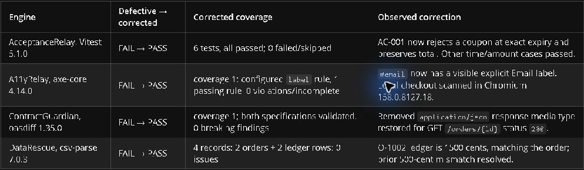

# The completed SwitchForge workflow

[Download The Release Signal, v2 (2:32)](https://github.com/YellankiKaushik/Flip-Coin-AI/releases/download/switchforge-demo-2026-v2/SwitchForge-2026-editorial-v2.mp4) · [Original film provenance](../history/DEMO-v1.md)

This is a completed synthetic release-review workflow using a real Mattermost conversation, Switch routing, the configured Codex agent and four actual tools. Existing GUI captures were taken read-only. Static evidence summaries are labeled. Neither animation nor the historical report implies a fresh interaction or current active approval.

Both runs have valid evidence. The defective run was `BLOCKED`; the separately reviewed corrected run reached `READY_FOR_HUMAN_APPROVAL`, with four PASS and zero blockers. The final Level 1 decision remains recorded as `HUMAN_ATTESTED_FOR_DEMO`; the current effective state is `EXPIRED`.

[Three human decisions](../human-review/PROCEDURE.md) · [Asset provenance](../assets/README.md) · [Reproduce the checks](../getting-started/README.md)

## Film and evidence sources

The final MP4 is 1920×1080 at 30 fps, H.264/yuv420p, 18,863,475 bytes, with 19 burned-in caption cues and no audio stream. Anonymous download returned HTTP 200 with matching SHA-256 `4fe4ead8a01ce7ee5d5fac1172cd5f8359e4eb718cf5883a79089717ec5b2cf5`. [Release page](https://github.com/YellankiKaushik/Flip-Coin-AI/releases/tag/switchforge-demo-2026-v2) · [Caption file](captions-v2.srt) · [Original v1 film](https://github.com/YellankiKaushik/Flip-Coin-AI/releases/download/switchforge-demo-2026-11-07/SwitchForge-2026-demo.mp4)

| Time      | Source and purpose                                                                                                                 |
| --------- | ---------------------------------------------------------------------------------------------------------------------------------- |
| 0:00–0:08 | Original signal illustration introduces the release decision.                                                                      |
| 0:08–0:36 | Actual Switch Console crop, existing Mattermost handoff, and actual Codex reply. The route graphic explains how the request moves. |
| 0:36–1:04 | Labeled evidence summaries show the defective assessment and exact reviewed correction.                                            |
| 1:04–1:16 | Matched crops of the original defective and corrected Chromium screenshots show the restored email label.                          |
| 1:16–1:45 | Actual corrected agent table, then a labeled summary of four valid passing checks and readiness.                                   |
| 1:45–2:03 | Labeled summary of the separate final decision and later effective expiry.                                                         |
| 2:03–2:32 | Actual public GitHub Actions capture, 137-test result, and repository URL.                                                         |

The v2 edit gives the actual request and reply separate closeups, uses the real checkout correction, and separates the recorded decision from effective expiry with a timed reveal. The existing conversation is shown through read-only still captures. The film's evidence summaries are editorial graphics derived from the recorded results.

| Defective screenshot                                                                         | Corrected screenshot                                                                           |
| -------------------------------------------------------------------------------------------- | ---------------------------------------------------------------------------------------------- |
|  |  |
